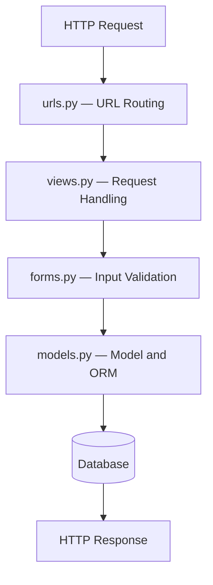

# Django HTTP Request Lifecycle

**Project:** Hisab-Kitab
**Topic:** Request routing, view handling, form validation, and database operations

## 1. Overview

When a user performs an action in Hisab-Kitab, such as creating a transaction, Django processes the HTTP request and returns an HTTP response.

Understanding this flow helps us debug requests, trace application behavior, and organize backend code.

## 2. Request Flow



This diagram represents a simplified transaction-creation flow. The actual lifecycle also involves middleware, authentication, error handling, and response rendering.

## 3. Responsibilities of Each Component

| Component | Responsibility |
|---|---|
| `urls.py` | Maps a requested URL to the appropriate view. |
| `views.py` | Handles the request and coordinates application logic. |
| `forms.py` | Validates submitted transaction data. |
| `models.py` | Defines the data structure and provides ORM operations. |
| Database | Stores and retrieves transaction records. |
| HTTP response | Returns the result to the client. |

## 4. Example: Creating a Transaction

Hisab-Kitab creates a transaction using the following sequence:

1. The browser submits an HTTP POST request.
2. Django URL routing directs the request to `transaction_create`.
3. The view creates a `TransactionForm` from the submitted data.
4. `form.is_valid()` checks the submitted values.
5. `form.save(commit=False)` creates a model instance without saving it yet.
6. `transaction.owner = request.user` associates the transaction with the authenticated user.
7. `transaction.save()` persists the transaction to the database.
8. The view redirects the user to the dashboard.

The relevant code from `transactions/views.py` is:

```python
if form.is_valid():
    transaction = form.save(commit=False)
    transaction.owner = request.user
    transaction.save()
```

## 5. Comparison with Spring Boot

A typical Spring Boot application may organize a similar request flow as:

```text
HTTP Request
    ↓
Controller
    ↓
Service
    ↓
Repository
    ↓
Database
    ↓
HTTP Response
```

In Django, the simplified flow is:

```text
HTTP Request
    ↓
URL Configuration
    ↓
View
    ↓
Form Validation (when applicable)
    ↓
Model and ORM
    ↓
Database
    ↓
HTTP Response
```

These are conceptual comparisons rather than exact equivalents.

Django does not require a separate service and repository class for every operation. Hisab-Kitab currently handles much of its request logic in views and uses Django's ORM for persistence.

## 6. Important Concepts

### URL Routing

URL patterns determine which view handles a request. They do not themselves execute the transaction's database operations.

### View

A view coordinates the request, applies application logic, and returns a response.

### Form Validation

Forms validate user input before the application saves the submitted data.

### ORM and Persistence

The model defines the data structure. Calling `save()` performs the database persistence operation.

### Authentication and Ownership

The view must ensure that the request is authenticated and that transaction operations are restricted to the appropriate user.

### Response

A response may render a template, return data, or redirect the browser to another URL.

## 7. Common Mistakes

- Assuming URL routing automatically saves data.
- Saving a model before assigning required values.
- Confusing form validation with database persistence.
- Assuming authentication alone guarantees transaction ownership.
- Treating a simplified request-flow diagram as the complete internal Django lifecycle.

## 8. Revision Questions

Try answering these without looking at the notes:

1. What is the responsibility of Django's URL configuration?
2. What does the view do in a request?
3. Why should form validation happen before saving a transaction?
4. Why do we use `commit=False` in transaction creation?
5. When does the transaction actually get saved?
6. How does this flow differ from a typical Spring Boot architecture?
7. Why must transaction ownership be checked separately from authentication?

## Key Takeaway

Understand the path from HTTP request to HTTP response, including where validation occurs and when database operations happen. This knowledge is useful for debugging, security, and designing maintainable backend applications.